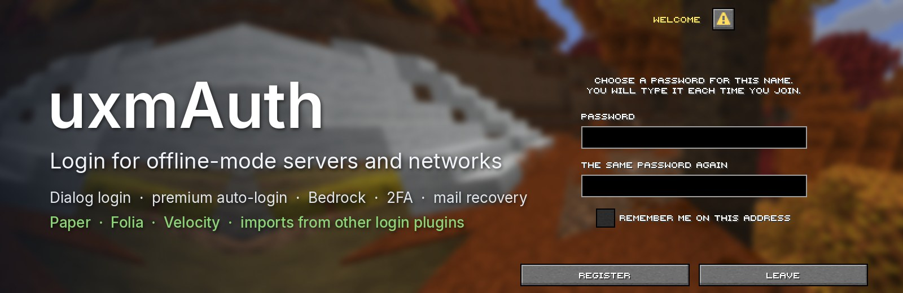
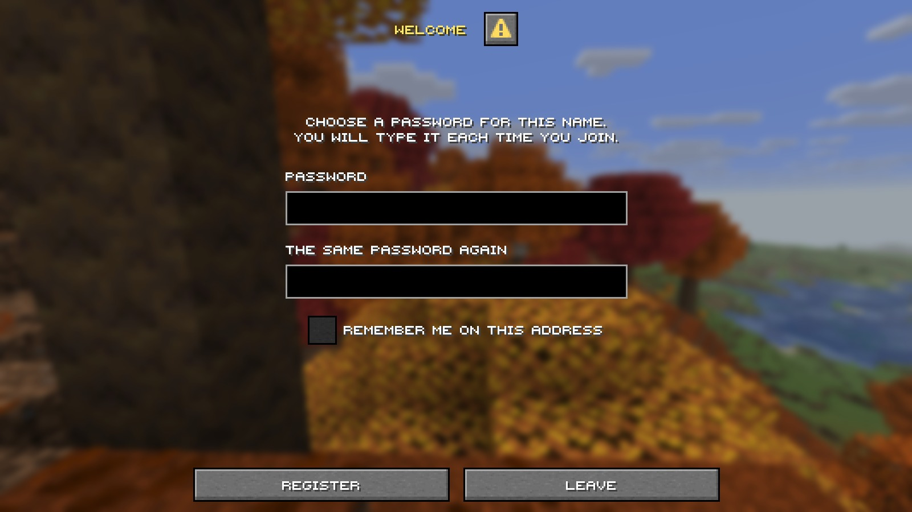

<p align="center">
  
</p>

<p align="center">
  <a href="https://github.com/UXPLIMA/uxm-auth/releases/latest"></a>
  <a href="https://github.com/UXPLIMA/uxm-auth/actions/workflows/ci.yml"></a>
  
</p>

**uxmAuth** is login and registration for offline-mode Minecraft servers and networks. A cracked player
registers in a window before they reach the world. A premium player and a Bedrock player never type a password.
Nobody can take a name that is not theirs. One plugin covers all of it, on a lone Paper or Folia server or a
whole Velocity network.

**[Download](https://github.com/UXPLIMA/uxm-auth/releases/latest)** ·
**[Manual](https://docs.uxplima.com/minecraft/plugins/uxmauth)** ·
**[Report a bug](https://github.com/UXPLIMA/uxm-auth/issues)**

## What it does

### Log in before the world



A new player chooses a password in a native dialog while the client is still connecting, so nothing of the
world is loaded until they are in. You can keep players frozen in the world instead, or send them to an empty
login world, and let them answer in chat. Passwords are stored with Argon2id by default; bcrypt, PBKDF2 and
AuthMe's SHA-256 are read too, and a player on an older one is moved over at their next login.

### Premium and Bedrock players skip the password

A name is checked against Mojang and three mirrors, so a slow or down Mojang does not lock anyone out. A paid
player joins without a password. Four ownership rules decide who may hold a paid name, from automatic to strict.
Bedrock players coming through Floodgate are logged in by their Xbox account and see native forms.

### Keep the wrong people out

- Sessions remember a player on the same address for as long as you allow.
- A second factor with an authenticator app or a mailed code, required for staff if you like.
- Password recovery by mail.
- Address bans that grow with every wrong password, limits on connections and new accounts per address,
  country filters and a captcha.
- A server that fails to start refuses every login instead of opening the door.

### Bring your accounts with you

Import accounts from AuthMe, nLogin, LibreLogin, JPremium, LimboAuth, FastLogin and six more login plugins.
Share your website's login table, or use a [Blysis](docs/user/blysis.md) website's members as the game's accounts
with one password for both, or move the whole database to another one with one command. SQLite works out
of the box; MySQL, MariaDB and PostgreSQL are a line in `config.conf`.

### Built for networks

On Velocity the proxy runs the premium check and tells each server who has logged in, with a claim signed by a
secret only your servers know. Players can wait in the proxy's own world through LimboAPI. With Redis, a
change such as a new password that ends every session reaches all proxies and servers at once.

PlaceholderAPI placeholders, a developer API with events, and every line in English and Turkish.

## Which jar goes where

- **A lone Paper or Folia server:** `uxmAuth-paper-<version>.jar` in `plugins/`.
- **A Velocity network:** `uxmAuth-velocity-<version>.jar` on the proxy and the Paper jar on every backend
  server. See [the network guide](docs/user/network.md).

Both jars come from the [releases page](https://github.com/UXPLIMA/uxm-auth/releases/latest) with a `SHA256SUMS`
file. Paper 26.3 and Java 25 are required. PlaceholderAPI, Vault, ViaVersion, Floodgate and LimboAPI are
optional. After the first start, run `/uxmauth doctor`: it prints one line for each thing that can be wrong.

## Build

```sh
./gradlew build
```

The jars are `uxmAuth-paper/build/libs/uxmAuth-paper-<version>.jar` and
`uxmAuth-velocity/build/libs/uxmAuth-velocity-<version>.jar`. More in [docs/README.md](docs/README.md).

By [UXPLIMA](https://github.com/UXPLIMA)
